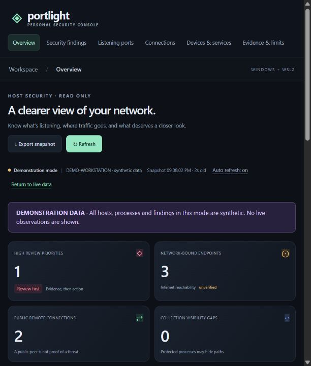

## Summary

**Portlight** answers a simple question: *what on my computer is listening on the network, where is it talking to, and what deserves a closer look?* A Windows PowerShell collector reads sockets, processes, services, and firewall profiles. It uploads a snapshot to a locked-down Docker container, which applies transparent review rules and serves a dashboard at `127.0.0.1:9090`.

{width=70%}

I built it for my AI 101–102 course as a human-in-the-loop project. The tool observes the machine and explains its evidence, but it never changes firewall settings or terminates processes on its own.

## Architecture

```{mermaid}
flowchart TB
    W[Windows socket, process,<br/>service & firewall APIs] -->|read-only| C[Collect-Windows.ps1<br/>PowerShell collector]
    C -->|token-authenticated<br/>loopback upload| S[Python server in Docker<br/>explainable review rules]
    S -->|polls every 5s| B[Browser dashboard<br/>HTML / CSS / JS]
```

## Features

- **Review queue** with High, Medium, Low, and Info priorities. Each finding shows the observed evidence, a confidence level, the reasoning, and suggested manual hardening steps.
- **Views** for listening ports, live TCP connections, devices and services, and an evidence-and-limits page that separates what is *observed*, *inferred*, *suspected*, and *unverified*.
- **Search and filters** by process, port, protocol, priority, and address scope, plus JSON export of snapshots.
- **Demo mode** with a clear synthetic-data banner. Demo data is never silently substituted when collection fails.

## Security and engineering choices

- The container runs as a non-root user with a read-only filesystem, all Linux capabilities dropped, and `no-new-privileges`. It's published on `127.0.0.1` only.
- Uploads require a random 256-bit token, created at startup and passed through an environment variable, and they must include a valid, size-bounded JSON payload. The token never reaches browser JavaScript.
- The front end has no CDNs, external fonts, or analytics, so nothing leaves the machine.
- **14 automated tests** cover IPv4/IPv6 scope handling, listener matching, stale and partial data, firewall profiles, and authentication. They passed on Python 3.11 and inside a Python 3.13 container.

[Browse the source code](https://github.com/CrampsP/CrampsP.github.io/tree/main/Full_Stack/portlight-system-monitor){.btn .btn-outline-primary}
