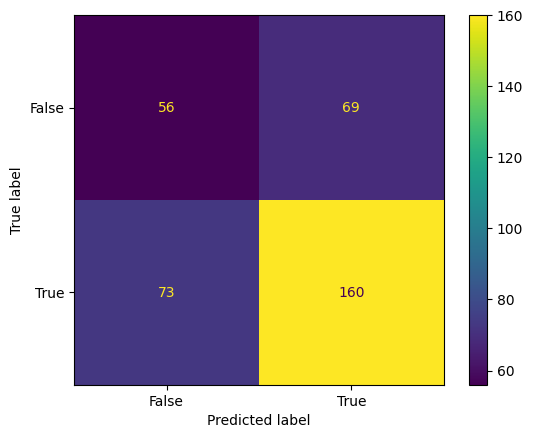

## Summary

A Portuguese bank wanted to know which customers are worth calling in its next term-deposit campaign. I filtered 37,069 customer records down to complete cases and one-hot encoded demographics, loan status, and economic indicators. Then I trained a **scikit-learn decision tree** to predict whether a customer subscribes.

## Approach

```python
# Remove rows with unknown values or the 999 "never contacted" placeholder
filtered_df = campaign[~campaign.apply(
    lambda row: row.astype(str).str.contains('unknown|999').any(), axis=1)].dropna()

X = pd.get_dummies(filtered_df[['job', 'marital', 'education', 'default', 'housing', 'loan',
                                'age', 'emp.var.rate', 'cons.price.idx', 'cons.conf.idx',
                                'euribor3m', 'nr.employed']], drop_first=True)
y = pd.get_dummies(filtered_df['y'], drop_first=True)

X_train, X_test, y_train, y_test = train_test_split(X, y, test_size=0.30)
clf = DecisionTreeClassifier().fit(X_train, y_train)
clf.score(X_test, y_test)   # 0.60
```

## Results

{width=55%}

The unpruned tree reached **60% accuracy**. It correctly flagged 160 of the 233 subscribers in the test set (69% recall), and its errors were split almost evenly: 69 false positives and 73 false negatives. Because only previously contacted customers lack the `999` placeholder, the strict filter kept just 1,193 rows, and subscribers became the majority class. My next iteration would impute those values instead of dropping them, limit tree depth to reduce overfitting, and compare against a random forest.

[View the notebook on GitHub](https://github.com/CrampsP/CrampsP.github.io/blob/main/Machine_Learning/notebooks/bank-marketing-starter.ipynb){.btn .btn-outline-primary}
