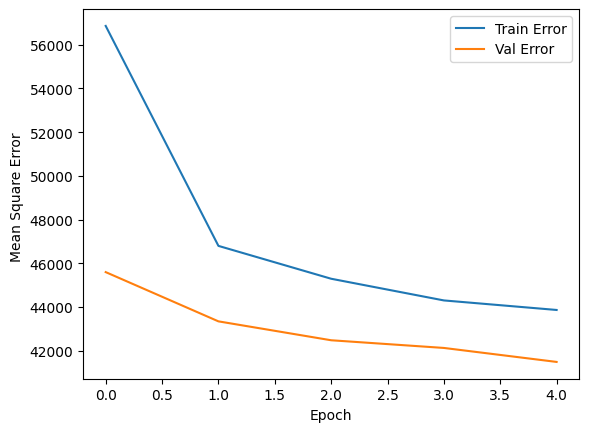
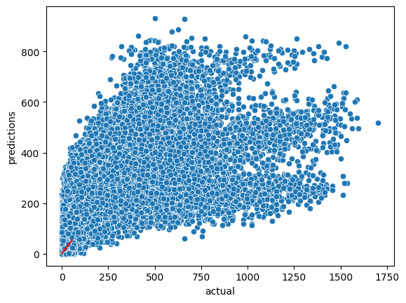

## Summary

A bike-share company wants to know how many registered riders to expect each hour so it can rebalance bikes. Using 112,475 hourly records, I built a fully connected neural network in **TensorFlow/Keras** and tuned it with `GridSearchCV`.

| Stage | Result |
|---|---|
| Baseline network (5 epochs) | Test RMSE ≈ 203 riders, R² ≈ 0.38 |
| Grid search best parameters | `tanh` activation, dropout 0.3, batch size 16 |
| Tuned network validation loss | Mean squared error fell from 35,067 to 16,865 over 5 epochs |

## Approach

- **Feature prep:** one-hot encoded season and weather situation, dropped the date and target columns, and scaled every feature with `MinMaxScaler`, fit only on the training split.
- **Architecture:** Dense(128) → Dropout → Dense(256) → Dense(64, leaky ReLU) → Dense(1, ReLU), so predictions can't go below zero.
- **Tuning:** wrapped the model with `scikeras.KerasRegressor` and searched over activation, dropout rate, and batch size with 3-fold cross-validation.

```python
def create_model(optimizer='adam', dropout_rate=0.5, activation='relu'):
    model = Sequential()
    model.add(Input(shape=(len(X_train[0]),)))
    model.add(Dense(128, activation=activation))
    model.add(Dropout(dropout_rate))
    model.add(Dense(256, activation=activation))
    model.add(Dense(64, activation='leaky_relu'))
    model.add(Dense(1, activation='relu'))
    model.compile(loss='mse', optimizer=optimizer)
    return model

param_grid = {
    'model__dropout_rate': [0.3, 0.5, 0.7],
    'model__activation': ['relu', 'tanh'],
    'batch_size': [16, 32, 64],
    'epochs': [3],
}
grid = GridSearchCV(KerasRegressor(model=create_model), param_grid,
                    scoring='neg_mean_squared_error', cv=3)
```

## Results

{width=70%}

{width=70%}

The baseline model captures the general pattern but underpredicts the busiest hours, which shows up as the flat band in the scatter plot. Grid search cut validation error roughly in half, which points to activation choice and lighter dropout as the biggest levers. Next steps would be training longer with early stopping and adding hour-of-day and day-of-week features.

[View the notebook on GitHub](https://github.com/CrampsP/CrampsP.github.io/blob/main/Machine_Learning/notebooks/bike-rental-demand-neural-network.ipynb){.btn .btn-outline-primary}
