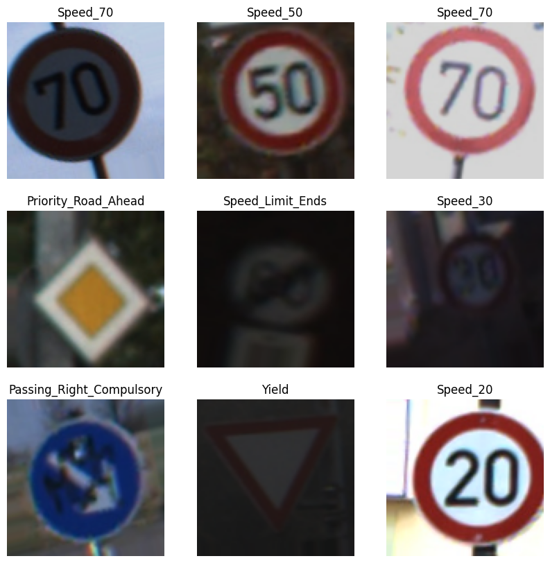

## Summary

For a self-driving car scenario, I trained a **convolutional neural network** to recognize 43 classes of traffic signs from about 39,000 labeled images. The data came from the German Traffic Sign Recognition Benchmark.

| Metric | Result |
|---|---|
| Training images / validation images | 31,368 / 7,841 |
| Training accuracy (epoch 11) | 95% |
| Validation accuracy (epoch 10) | **88%** |
| Parameters | 1.87 million |

{width=75%}

## Approach

- **Augmentation:** random rotation (±15°), shifts, shear, zoom, and a custom HSV brightness adjustment. These simulate signs seen at different angles and in different lighting.
- **Architecture:** three convolutional layers (32 → 64 → 64 filters) with max pooling, then a dense layer with a 43-way softmax output.
- **Pipeline:** Keras `ImageDataGenerator` streams images from disk with an 80/20 train/validation split, and the trained model predicts the holdout set for competition scoring.

```python
model = models.Sequential([
    layers.Conv2D(32, (3, 3), activation='relu', input_shape=(100, 100, 3)),
    layers.MaxPooling2D((2, 2)),
    layers.Conv2D(64, (3, 3), activation='relu'),
    layers.MaxPooling2D((2, 2)),
    layers.Conv2D(64, (3, 3), activation='relu'),
    layers.Flatten(),
    layers.Dense(64, activation='relu'),
    layers.Dense(43, activation='softmax'),
])
```

## Lessons learned

When I stopped training early, the saved model collapsed to predicting a single class on the holdout set. The cause was a loss-function mismatch: `from_logits=True` combined with a softmax output layer. The fix is to compile with `from_logits=False` and add an `EarlyStopping` callback that restores the best weights. Tracking that down taught me to check a model's prediction distribution, not just its accuracy, before submitting.

[View the notebook on GitHub](https://github.com/CrampsP/CrampsP.github.io/blob/main/Machine_Learning/notebooks/traffic-sign-image-classifier-cnn.ipynb){.btn .btn-outline-primary}
